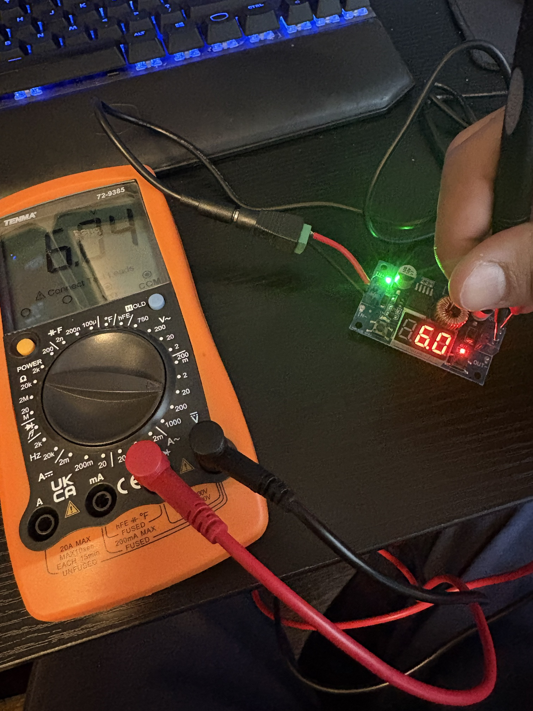
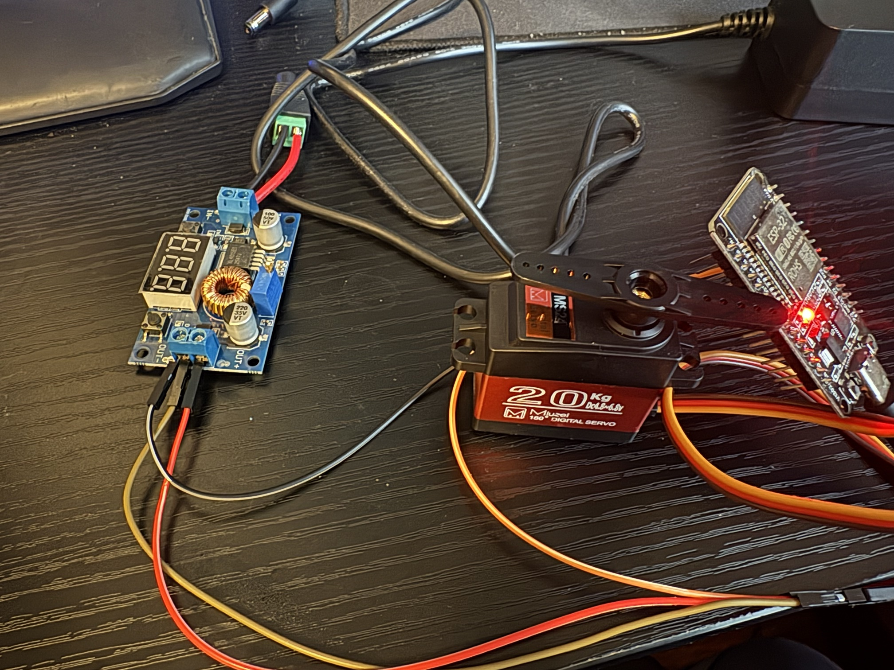
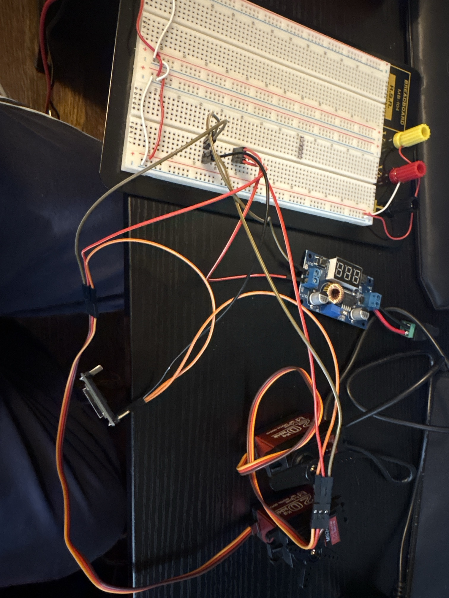

# Autonomous Thermal-Guided Flame Suppression Turret
Swiveling, heat-detecting mounted blower for putting out small nearby heat sources.

---

## Table of Contents
1. [Overview](#overview)
2. [Components](#components)
3. [Wiring](#wiring)
4. [Hardware Setup](#hardware-setup)
5. [Power Notes](#power-notes)
6. [Photos](#photos)

---

## Overview
A stationary pan/tilt turret controlled by an ESP32. When idle it sweeps back and forth looking for heat. A 32x24 thermal camera mounted next to the blower nozzle finds the hottest spot, the turret turns until that spot is centered, and a 12V blower fan puts the flame out. Once the temperature drops it goes back to sweeping.

- **Purpose:** learn ESP32 programming, thermal sensing, and servo control with a build that reacts to real heat.
- **V1:** working prototype with no soldering. Power is split with lever wire connectors, signals use jumper wires, and the ESP32, buck converter, and MOSFET module all mount on the printed base. One 12V cord powers everything. Built for small test flames like a candle.
- **V2:** cleaner, more compact build with a custom PCB.

---

## Components

| Part | Use |
|------|-----|
| AITRIP ESP32 DevKit (ESP-WROOM-32, 30 pin, USB-C, CP2102) | Main controller |
| MLX90640-D55 thermal camera (32x24, 55° FOV, I2C) | Finds the flame |
| 2x Miuzei 20kg metal gear servos (180°) | Pan and tilt |
| GDSTIME 7530 12V brushless blower fan | Blows the flame out |
| MOSFET switch module (dual MOS, 4-60V) | Lets the ESP32 turn the 12V fan on and off |
| 12V 5A power supply (5.5x2.1mm barrel plug) | Main power |
| HiLetgo XL4015 5A buck converter with voltmeter | Steps 12V down to 6V for the servos |
| Inline fuse holder + mini blade fuses | Protects the 12V line |
| 30cm servo extension cables | Servo wiring |
| Breadboard + jumper wires | Bench testing and signal connections |
| Lever wire connectors | Splitting 12V, 6V, and ground without soldering |
| M2-M5 screw kit + servo horn screws | Mounting |
| Bambu Lab A1 mini + black PLA | Printed base, pan bracket, and tilt head (`cad/`) |

---

## Wiring
- **12V supply** -> barrel jack screw terminal adapter -> XL4015 buck converter IN+ / IN-
- **Buck converter OUT+ (6V)** -> breadboard + rail
- **Buck converter OUT-** -> breadboard - rail
- **Breadboard + rail** -> pan and tilt servo red
- **Breadboard - rail** -> pan and tilt servo brown + ESP32 GND (shared ground)
- **ESP32 GPIO 18** -> pan servo signal (orange)
- **ESP32 GPIO 19** -> tilt servo signal (orange)
- **ESP32 3V3 / GND** -> MLX90640 VCC / GND
- **ESP32 GPIO 21 / 22** -> MLX90640 SDA / SCL

---

## Hardware Setup
1. **Buck converter**
   - The servos can't take 12V, so the XL4015 steps the 12V supply down to 6V for them.
   - Connected the 12V supply to the XL4015 input through a barrel jack screw terminal adapter.
   - With nothing on the output, turned the adjustment screw until the display read 6.0V.
   - Checked the output with a multimeter: 6.04V.
2. **Pan servo**
   - Wired one servo to the 6V buck output with jumper wires, signal to ESP32 GPIO 18.
   - The ESP32 GND is tied to the buck OUT- so the servo and ESP32 share the same ground.
   - Test sketch moves the servo center, left, center, right using the ESP32Servo library (`firmware/pan_servo_test`).
3. **Tilt servo**
   - Moved the servo power to a breadboard so each wire gets its own spot instead of stacking them in the buck's screw terminals.
   - Buck output goes to the breadboard rails, both servos and the ESP32 GND plug into the rails.
   - Tilt signal goes to ESP32 GPIO 19.
   - Test sketch moves both servos together, tilt with a smaller range since it will be limited once mounted (`firmware/pan_tilt_test`).
4. **Thermal camera**
   - The MLX90640 talks to the ESP32 over I2C (SDA on GPIO 21, SCL on GPIO 22) and runs off the ESP32's 3.3V.
   - Test sketch reads the full 32x24 frame 4 times a second and prints the coldest and hottest temperature. Room reads around 20-25°C, a hand around 30-35°C (`firmware/thermal_test`).
5. **Finding the hot spot**
   - Searches the frame for the hottest pixel and prints its grid position (`firmware/hotspot_test`).
   - With the camera's connector facing down, the sensor is turned 90°: the 32 pixel side runs up/down (x goes up as the hot spot moves up) and the 24 pixel side runs left/right (y goes up toward the camera's left). The aiming code uses x for tilt and y for pan.
6. **Printed turret parts**
   - Three parts printed in PLA on one A1 mini plate (`cad/turret_v1_all_parts.3mf`).
   - Base: holds the pan servo upright with the shaft over the center, wide footprint so it sits stable on a desk.
   - Pan bracket: mounts to the pan servo's cross horn and holds the tilt servo on its side.
   - Tilt head: mounts to the tilt servo's cross horn, holds the blower by its outlet with the thermal camera right above the nozzle so they point the same way.
   - First prints are light test-fit versions.

---

## Power Notes
- Servos run off the 6V buck output, never off the ESP32.
- The two servos can pull 2A+ each when starting or stalled, which is why the buck converter is the 5A XL4015.
- The fan runs straight off 12V through the MOSFET module.
- The ESP32 is powered over USB while testing. The finished V1 runs it off the 6V rail through its VIN pin so the 12V supply is the only cord.
- The inline fuse sits on the 12V line right after the supply.

---

## Photos
- Buck converter set to 6V, multimeter reading 6.04V on the output
   
  

- Pan servo wired to the buck converter and ESP32
   
  

- Both servos running off the breadboard power rails
   
  
